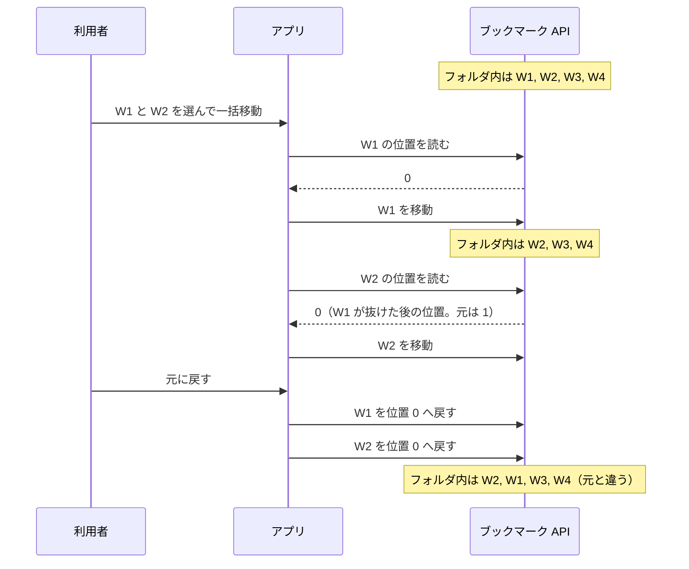

# 段階 8：レポートの形式

読み手が 2 種類いるので、ファイルを 2 つ書く。

| ファイル | 読み手 | 目的 |
|---|---|---|
| `.dokumi/report.md` | 人（レビュアー） | 何を信じてよく、どこを自分で見るべきかが 1 分で分かる |
| `.dokumi/report.json` | 生成エージェント | 指摘を 1 件ずつ機械的に処理して修正できる |

内容は同じものを指す。`report.md` の指摘の番号と `report.json` の `id` を揃える。

## 目次

この文書は長い。`report.md` の形だけを読んで `report.json` を書かない。項目名は下の「report.json」の節で決まっている。

- [件数の数え方](#件数の数え方)
- [重大度](#重大度)
- [report.md](#reportmd)：構成の例、書き方、図を付けるとき、PASS のとき、ESCALATE のとき、再検証のとき
- [report.json](#reportjson)：例と、項目ごとの意味（`findings[]` には `severity`、`file`、`line`、`fix` が要る）
- [差し戻しを受けた側（生成エージェント）の進め方](#差し戻しを受けた側生成エージェントの進め方)

## 件数の数え方

冒頭の「blocker / warning / note」は指摘の件数。実施できなかった検査（lint が未設定、axe がない、など）は指摘ではないので数えず、「段階ごとの結果」の補足と「未証明・未確認」に書く。

完了報告との食い違い、検証の副作用、PR に混ぜないよう知らせる入力ファイルは、それぞれの節に書き、件数には入れない。

同じ根本原因の指摘は 1 件にまとめる。`mutants-triage.json` の `summary` はミュータント単位の件数なので転記しない（指摘の件数は `groupSummary`）。mutator の未検出は `mutants-triage.json` の `groups` の 1 行を 1 件とする（9 個のミュータントが 1 つのテスト不足から来ているなら、指摘は 1 件）。

## 重大度

| 重大度 | 意味 | PR への影響 |
|---|---|---|
| `blocker` | 実行で証明された問題 | PR を作らない |
| `warning` | 証明はできていない懸念、または証明済みだが PR を止めるほどではないもの | PR 本文に載せて人に委ねる |
| `note` | 参考情報、変更前からあった問題 | PR 本文には載せない（`report.md` には残す） |

## report.md

下の構成を守る。該当なしの節は「なし」と書く（節ごと消すと、確認していないのか問題がなかったのか区別できない）。

```markdown
# dokumi レポート

**判定: FIX**（1 回目）　blocker 2 件 / warning 3 件（うち判断が要るもの 1 件） / note 1 件
要件: 4 項目中 3 項目を確かめた（満たす 2、満たさない 1）。未確認 1 項目
モード: `standard` / `onWarning: report`
ベース: `origin/main` (a1b2c3d) → 作業ツリー　変更 7 ファイル

## 要約
- 検索フォームの追加は要件 4 項目中 2 項目を満たす。空入力時にボタンが無効にならない（B1）。履歴の期限（R4）は確かめられていない。
- エラー時の分岐をどのテストも実行していない（B2）。
- 型・lint・既存テスト・ビルドは通過。実ブラウザで 375px と 1280px を確認済み。

## 段階ごとの結果
| 段階 | 結果 | 補足 |
|---|---|---|
| 1 機械ゲート | 通過 | typecheck / lint / test (42 件) / build。カバレッジのしきい値（行 80%）: 84.2% で合格 |
| 2 ごまかし検出 | warning 1 | `any` 1 か所 |
| 3 要件適合 | blocker 1 | 独立レビューあり。捨てた指摘 1 件 |
| 4 テストの質 | blocker 1, warning 2 | mutator 0.4.0、変更行の未検出 5 件。検出率 71%（24 件中 17 件）。範囲を広げた 2 回目も完了。型エラーで未実測 0 |
| 5 影響範囲 | 証明済み（段階 4） | `SearchInput` は新規で、既存の呼び出し元なし |
| 6 実ブラウザ | blocker は B1 と同じ | `/search` をモバイル幅とデスクトップ幅で確認 |
| 7 フロントエンド観点 | warning 0 | 状態・a11y・レスポンシブを確認 |

## 要件ごとの確認
| 要件 | 判定 | 確かめた手段（実行したもの） |
|---|---|---|
| R1 検索欄が空なら検索ボタンを押せない | 満たさない（B1） | 実ブラウザ「R1 空のとき検索ボタンが無効」 |
| R2 取得に失敗したらエラーを表示する | 満たす | 実ブラウザ「R2 取得失敗時にエラーを表示する」（API は 500 を返すようモック） |
| R3 検索語は前後の空白を除いて送る | 満たす | 再現テスト `.dokumi/review/trim.test.ts`、既存テスト `normalize.test.ts` |
| R4 履歴は 30 日で消える | 未確認 | 日付を進める手段がなく、実行で確かめていない |

## blocker
### B1. 空入力でも検索ボタンを押せる
- 場所: `src/features/search/SearchForm.tsx:31`
- 要件: 「検索欄が空なら検索ボタンを押せない」
- 証拠:
  ```
  $ node .dokumi/browser-check.mjs
  { "check": "空のとき検索ボタンが無効", "pass": false }
  ```
  スクリーンショット: `.dokumi/shots/search-mobile.png`
- 実害: 確認済み。`/search` を開いた直後の状態で、誰でも起きる。
- 直し方: `disabled` の条件が `query === undefined` になっている。空文字と空白のみも無効にする。

### B2. エラー時の分岐をどのテストも実行していない
- 場所: `src/features/search/useSearch.ts:18-24`
- 証拠: mutator `notReached` 3 件（key: `1ufduz48mg4`, `137iu1zwifk`, `101x6pelqtr`）
- 直し方: 取得が失敗したときにエラーメッセージが表示されることを確かめるテストを足す。

## warning
### W1. `any` の追加
- 場所: `src/features/search/api.ts:12`
- 内容: API レスポンスを `any` で受けている。スキーマでパースすることを提案。

### W2. 【判断が要る】ナビゲーションへのリンク追加に自動テストがない
- 場所: `src/App.tsx:20-25`（どのテストも実行していない、mutator `notReached` 9 件）
- 確かめたこと: 実ブラウザでリンクから `#/search` に遷移し、検索ページが表示される（`.dokumi/browser-check.head.json` の「ナビから検索ページへ遷移」）
- 判断してほしいこと: 自動テストなしで通すか、`App` のルーティングのテストを足すか

### W3. 未検出ミュータント 2 件（修正を 1 回試みる）
- `src/features/search/normalize.ts:8` `trim()` を削除しても落ちない（key: `k3kgc6il0y`）
- …

## 完了報告との食い違い
| 完了報告の主張 | 実際 | 根拠 |
|---|---|---|
| 「4 つの要件すべてにテストを追加、全件通過」 | エラー表示のテストは `test.skip`。`npm test` は 9 passed / 1 skipped | B2、`.dokumi/gate-test.log` |

## 受け入れ提案（人が決める）
等価と考えるミュータント。エージェントは `mutator accept` を実行していない。

| key | 場所 | 変更 | 等価と考える理由 |
|---|---|---|---|
| `s1nb18phao` | `src/features/search/SearchForm.tsx:44` | `items?.length` → `items.length` | `items` は直前の行で配列であることを確認済み |

承認する場合: `npx mutator accept s1nb18phao --reason "<理由>"`

## 未証明・未確認
- 要件: R4（履歴は 30 日で消える）。日付を進める手段がなく、実行で確かめていない。
- 影響範囲: なし
- 実ブラウザ: エラー表示は API をモックして確認。実 API では未確認。axe は 2 状態を検査し、判定が保留されたコントラスト 6 要素のうち 5 要素を測って基準内、1 要素は背景が画像で測れず。

## 確認済み（問題なしと判断したもの）
- `eslint-disable-next-line react-hooks/exhaustive-deps`（`useSearch.ts:9`）: 既存行の移動で、今回の追加ではない。

## 捨てた指摘
- 独立レビューの「デバウンスが効かない」: 再実行したところ 300ms で 1 回だけ呼ばれており、再現せず。

## 検証の副作用
- なし（作業ファイルは `.dokumi/` と `.mutator/` に置き、ローカルの除外設定に入れた。検証対象の差分は検証前と一致）。
- 作業ツリーに未追跡の `REQUIREMENTS.md` がある。PR に含めないよう注意。

## 人が見るべき箇所
1. `src/features/search/useSearch.ts` の競合対策（古い応答の破棄）。動作は確認したが、設計の是非は判断していない。
```

### 書き方

- **判定を最初に書く。** 読み手が最初に知りたいのは、PR にしてよいかどうか。
- **判定の次の行に、確かめた要件の数を書く。** PASS は「確かめた項目は通った」という意味で、確かめなかった要件については何も言っていない。「17 項目中 17 項目を確かめた」と「17 項目中 11 項目を確かめた」は、同じ PASS でも信じてよい範囲が違う。
- **「要件ごとの確認」は、要件の番号を 1 つも省かずに並べる。** 「確かめた手段」には実行したものを書く（実ブラウザの確認項目の名前、テストやスクリプトのファイル、コマンド）。「コードを読んだ」「独立レビューが満たすと答えた」は手段にならない。書ける手段がない要件は「未確認」にし、理由を添える。
- **「未確認」の要件は、選ばずに全部「未証明・未確認」に載せる。** 自分で気づいた分だけを載せると、気づかなかった漏れが PASS の陰に隠れる。未確認の要件が要件の中心にかかわるなら、判定は ESCALATE（SKILL.md の段階 8）。その場合は、判断が要る warning（要件の中心にかかわる未確認）としても 1 件にまとめて載せ、件数に数える。
- **要約は 3 行程度。** 何が満たされ、何が満たされず、何を確かめたか。
- **blocker には実害の確認状況を書く。** 「要件に反すると証明できた」ことと「今のユーザーやデータで実際に起きている」ことは別で、後者が直す順番を決める。次のどれかを 1 行で書く。
  - **確認済み**：どの操作、どのデータで起きるか（「初期表示で誰でも起きる」「実データ 53 点のうち 4 点が該当」）。
  - **現在は未発生**：条件を満たす入力が今は存在しないと確かめた（「彩度 0.65 を超えるネイビーが実データに 1 点もない」）。確かめたコマンドか根拠を添える。
  - **未確認**：実データや本番の状態が手元になく、確かめていない。

  「現在は未発生」でも blocker のままにする（要件違反は証明済みで、入力が変われば起きる）。重大度は変えず、この行で区別する。要約では、実害が確認済みのものを先に書く。
- **証拠は実際の出力を貼る。** 「テストが失敗した」ではなく、コマンドと出力の該当行。長い出力は該当部分だけを貼り、全体はログファイルの場所を示す。
- **完了報告の主張は 1 つずつ裏を取る。** 食い違いは専用の節に並べる。生成エージェントの報告がどこまで信用できるかは、人がこの PR を読む深さを決める材料になる。
- **確かめていないことを確かめたように書かない。** 飛ばした段階、未実測のミュータント、到達できなかった画面は「未証明・未確認」に書く。
- **「人が見るべき箇所」は絞る。** 検証では判断できない設計や仕様の是非だけを挙げる。全ファイルを並べない。0 件なら「特になし」。

### 図を付けるとき

手順や状態が絡む不具合は、文章だけだと、読み手が頭の中で順番を組み立て直すことになる。blocker、判断が要る warning、「決めてほしいこと」には、次の場合に Mermaid の図を付ける。`report.md` の図は、GitHub でもエディタのプレビューでもそのまま表示される。

| 付ける | 付けない |
|---|---|
| 操作や API 呼び出しの順序、どの時点の値を使ったかが要点の不具合 | 1〜2 行で言い切れる事実（設定値の誤り、記載漏れ、文言の違い） |
| 状態の移り変わりの中で、期待と実際が分かれる不具合 | 証拠の出力をそのまま読めば分かるもの |
| 選択肢ごとに動作がどう変わるかを見せたい判断事項 | |

| 伝えたいこと | 図の種類 |
|---|---|
| 操作と呼び出しの順序、どの時点の値を使ったか | `sequenceDiagram` |
| 状態の移り変わりと、想定していない遷移 | `stateDiagram-v2` |
| 分岐のどこで期待から外れるか、選択肢ごとの結果 | `flowchart` |

書き方：

- **図の前に、同じ内容を 1 文で書く。** 端末のように図が表示されない場所でも、その 1 文で要点が伝わる。会話の中で判定を伝えるときは、図のソースを貼らず、この 1 文を使う。
- **図は説明で、証拠ではない。** 再現のコマンドと出力は、図があっても必ず載せる（原則 1）。
- **描くのは、実行で確かめた値と順序だけ。** 推測した経路や、確かめていない状態は描かない。
- **図と証拠の出力を食い違わせない。** 再検証で動作が変わったら、図も直すか消す。
- **1 つの指摘に図は 1 つ。** 登場者は 3〜4、矢印は 10 前後まで。超えるなら、指摘を分けるか、図をやめて表にする。
- **基本の記法だけを使う。** GitHub の Mermaid は最新版とは限らない。
- `report.json` には入れない。エージェント向けには `evidence` と `fix` で足りる。

例（一括で移動してから「元に戻す」と、並びが元と変わる不具合）：

````markdown
1 件ずつ動かしながら位置を読むので、2 件目の位置が「1 件目が抜けた後の位置」で記録され、元に戻すと順番が入れ替わる。


````

#### 図を確かめる

記法が崩れた図は、図ではなくエラーとして表示される。図を付けたら、実際に描画して確かめる。段階 6 と同じ Playwright を使い、Mermaid は axe と同じくプロジェクトの外に取得する。

```sh
mkdir -p .dokumi/tools/mermaid && (cd .dokumi/tools/mermaid && npm pack mermaid@11 --silent && tar -xzf mermaid-*.tgz package/dist/mermaid.min.js)
node $SKILL/scripts/check-mermaid.mjs .dokumi/report.md      # 終了コード 1 は、描画できない図がある
```

描画できた図は `.dokumi/shots/diagram-<番号>.png` に保存される。画像を開いて、矢印の向きと順番、注記の位置が意図どおりかを見る（描画できることと、正しい図であることは別）。描画できない図は、出力の `error` を読んで直す。直せなければ図を外し、文章だけにする。

Playwright がない、Mermaid を取得できない、のどちらかで確かめられなかったときは、依存を足さず、「図は描画を確かめていない」と「未証明・未確認」に書く。

### PASS のとき：PR 本文に入れる節

`report.md` の末尾に、PR 本文にそのまま貼れる節を付ける。

```markdown
## 検証（dokumi）
- 判定: PASS（修正 1 回）
- 要件: 4 項目中 3 項目を確かめた。未確認 1 項目（下記）
- 型 / lint / テスト 45 件 / ビルド: 通過
- ミューテーション検出率: 92%（diff 内 24 件中 22 件）。残り 2 件は下記
- 実ブラウザ: `/search` を 375px と 1280px で確認。コンソールエラーなし

### レビュアーに判断してほしいこと
- 未検出ミュータント 1 件: `normalize.ts:8` の `trim()`。テストを足すか、不要なら削除するか
- 等価ミュータントの受け入れ提案 1 件: `SearchForm.tsx:44`（理由と承認コマンドは上記）

### 未確認
- R4 履歴は 30 日で消える（日付を進める手段がなく、実行で確かめていない）
- 実 API でのエラー表示（モックでのみ確認）
```

スクリーンショットは、PR に画像を添付できる手段があれば添付する。なければファイルの場所を書くだけにとどめ、`.dokumi/` をコミットしない。

### ESCALATE のとき

「人が見るべき箇所」の代わりに、決めてほしいことを 1 つずつ問いの形で書く。それぞれに、選択肢と、どちらを選ぶと何が変わるかを添える。

```markdown
## 決めてほしいこと
1. 検索欄が空白だけのとき、検索ボタンを押せるようにするか（B1）。
   - A（推奨）押せなくする: 空白だけの入力を空と同じに扱う。空白だけの検索は結果が 0 件になるだけなので。`disabled` の判定に `trim()` を足す。
   - B 押せるままにする: 現在の実装のまま。B1 は要件の読み違いとして取り下げる。
2. 取得に失敗したとき、再試行のボタンを出すか（W2）。
   - A（推奨）出さない: 要件にない。エラー文だけを出す現在の実装のまま。
   - B 出す: 要件に 1 項目足す。実装とテストの追加が要る。
```

人は「1 は A、2 は B」のように番号と記号だけで答える。それで意図が通じるように書く。

- **問いは、それだけ読んで分かるようにする。** 「B1 をどうするか」「上記の件」と書かず、何がどうなっているかを問いの中に書く。対応する指摘の番号は末尾に添える。
- **選択肢には A、B の記号を振り、推奨を A に置いて「（推奨）」と書く。** 推奨の理由を 1 文で添える。推奨がないなら、ないと書く。
- **選択肢ごとに、選んだ結果を書く**（何を変えるか、何が残るか）。選択肢の名前だけでは決められない。
- **1 回に出す問いは絞る。** どちらを選んでも実装が変わらないものは、問いにせず warning に載せる。

### 再検証のとき（2 回目以降）

始める前に、前の回の `report.md` と `report.json` を `report-round<N>.md` / `report-round<N>.json` に写す（上書きされるため。前回の指摘は、修正の再検証の入力になる）。

回を重ねると、前の回から手を付けていない warning と note が溜まり、今回新しく分かったことが埋もれる。前の回と同じ内容の指摘は本文に再掲せず、末尾の節にまとめる。

```markdown
## 持ち越し（前の回から変わっていない指摘）
| 番号 | 重大度 | 題名 | 初出 |
|---|---|---|---|
| W3 | warning | 未検出ミュータント 2 件（`normalize.ts`） | 1 回目 |
| N1 | note | `HomePage` の既存のコンソール警告 | 1 回目 |

詳細は `.dokumi/report-round1.md`。
```

- 持ち越せるのは warning と note だけ。blocker は毎回本文に書く。
- 番号は前の回のものを保つ。冒頭の件数には持ち越しも含め、「warning 5 件（うち持ち越し 2 件）」と内訳を書く。
- 判断が要る warning は、人がまだ答えていなければ持ち越しにせず、本文の「判断してほしいこと」に残す。
- 前の回の blocker は、「段階ごとの結果」の下に、解消したかどうかを 1 行ずつ書く（「B1: 解消。`recheck` が通過」）。

## report.json

```json
{
  "verdict": "FIX",
  "round": 1,
  "mode": "standard",
  "onWarning": "report",
  "base": { "ref": "origin/main", "mergeBase": "a1b2c3d" },
  "summary": { "blocker": 2, "warning": 3, "note": 1 },
  "requirements": [
    { "id": "R1", "text": "検索欄が空なら検索ボタンを押せない", "status": "violated", "evidence": ["browser: R1 空のとき検索ボタンが無効"], "finding": "B1" },
    { "id": "R2", "text": "取得に失敗したらエラーを表示する", "status": "met", "evidence": ["browser: R2 取得失敗時にエラーを表示する"] },
    { "id": "R3", "text": "検索語は前後の空白を除いて送る", "status": "met", "evidence": [".dokumi/review/trim.test.ts", "test/normalize.test.ts"] },
    { "id": "R4", "text": "履歴は 30 日で消える", "status": "unverified", "evidence": [], "why": "日付を進める手段がない" }
  ],
  "stages": [
    { "id": 1, "name": "gate", "status": "pass", "detail": "typecheck, lint, test (42), build" },
    { "id": 4, "name": "test-quality", "status": "fail", "detail": "mutator 0.4.0, score 0.71, pending 0" },
    { "id": 6, "name": "browser", "status": "fail", "detail": "/search @ 375, 1280" }
  ],
  "findings": [
    {
      "id": "B1",
      "severity": "blocker",
      "stage": 3,
      "title": "空入力でも検索ボタンを押せる",
      "file": "src/features/search/SearchForm.tsx",
      "line": 31,
      "requirement": "検索欄が空なら検索ボタンを押せない",
      "evidence": {
        "command": "node .dokumi/browser-check.mjs",
        "output": "{ \"check\": \"空のとき検索ボタンが無効\", \"pass\": false }",
        "artifacts": [".dokumi/shots/search-mobile.png"]
      },
      "fix": "disabled の条件で空文字と空白のみも無効にする。",
      "impact": { "status": "observed", "detail": "/search を開いた直後の状態で誰でも起きる" },
      "fixTried": true,
      "fixTrialResult": "コピー上で適用し、再現テストと既存テスト 9 件が通過",
      "recheck": "node .dokumi/browser-check.mjs"
    },
    {
      "id": "B2",
      "severity": "blocker",
      "stage": 4,
      "title": "エラー時の分岐をどのテストも実行していない",
      "file": "src/features/search/useSearch.ts",
      "line": 18,
      "evidence": { "command": "npx mutator --since a1b2c3d --reporter agent", "output": "notReached x3" },
      "mutantKeys": ["1ufduz48mg4", "137iu1zwifk", "101x6pelqtr"],
      "fix": "取得失敗時にエラーメッセージが表示されることを確かめるテストを足す。",
      "recheck": "npx mutator --only 1ufduz48mg4 --only 137iu1zwifk --only 101x6pelqtr --reporter agent"
    }
  ],
  "acceptProposals": [
    {
      "key": "s1nb18phao",
      "file": "src/features/search/SearchForm.tsx",
      "line": 44,
      "change": "items?.length -> items.length",
      "reason": "items は直前の行で配列であることを確認済み"
    }
  ],
  "unproven": ["R4 履歴は 30 日で消える（日付を進める手段がない）", "実 API でのエラー表示（モックでのみ確認）"],
  "dropped": [{ "source": "independent-review", "title": "デバウンスが効かない", "why": "再実行で再現せず" }],
  "claimMismatches": [
    { "claim": "4 つの要件すべてにテストを追加、全件通過", "actual": "エラー表示のテストは test.skip（9 passed / 1 skipped）", "finding": "B2" }
  ],
  "sideEffects": [],
  "decisionsNeeded": []
}
```

### 項目

- `verdict`：`PASS` / `FIX` / `ESCALATE`。
- `mode` / `onWarning`：使ったモード。
- `round`：何回目の検証か（1 から）。人の判断を挟まない修正と再検証は 2 回まで（直らなければ `ESCALATE`）。人が ESCALATE に答えた後や、改めて検証を頼まれた後も、番号は通しで増やす。
- `requirements[]`：要件の番号ごとの判定。`status` は `met`（満たす）/ `violated`（満たさない）/ `unverified`（未確認）。`evidence` には実行したものを入れる。`evidence` が空なら `status` は `unverified` で、`why` に理由を書き、同じ内容を `unproven` にも入れる。`violated` には対応する指摘の `id` を `finding` に入れる。
- `stages[].status`：`pass` / `fail` / `skipped`。`skipped` には `detail` に理由を書く。
- `findings[]`：`blocker` を先に。すべての `blocker` に `evidence.command` と `evidence.output` が必要（なければ `warning` に下げる）。
- `findings[].fix`：何をどう直すかを具体的に。「テストを改善する」のような指示は不可。
- `findings[].needsDecision`：warning のうち、人の判断が要るもの（SKILL.md の「判断が要る warning」）に `true`。`onWarning: ask` のとき、これが 1 件でもあれば `verdict` は `ESCALATE` で、同じ内容を `decisionsNeeded` に問いの形で入れる。
- `findings[].impact`：blocker に付ける。`status` は `observed`（実害を確認済み）/ `latent`（現在は未発生）/ `unknown`（未確認）。`detail` にどの操作・データで起きるか、または起きないと確かめた根拠を書く。差し戻しを受けた側は `observed` から直す。
- `findings[].fixTried`：その直し方をコピーの上で試したか。試したなら `fixTrialResult` に結果を書く。試していない直し方は `false` にして、推測であることが分かるようにする。
- `findings[].recheck`：その指摘が直ったことを確かめるコマンド。再検証で使う。
- `findings[].carriedFrom`：前の回から変わっていない warning / note に、初出の回の番号を入れる（`report.md` の「持ち越し」）。
- `claimMismatches[]`：完了報告の主張のうち、実際と食い違うもの。対応する指摘の `id` を `finding` に入れる。なければ空配列。
- `decisionsNeeded[]`：`ESCALATE` のとき、人に決めてほしいこと。`{ "id", "question", "findings": ["B1"], "options": [{ "label": "A", "choice", "consequence", "recommended": true }] }`。`report.md` の「決めてほしいこと」と番号、記号を揃える。

## 差し戻しを受けた側（生成エージェント）の進め方

1. `report.json` の `findings` を `blocker` から順に処理する。`warning` は 1 回だけ修正を試みる。
2. 各指摘を直したら、その `recheck` を実行して解消を確かめる。
3. 指摘が誤りだと考えるなら、直さずに、誤りだと示す実行結果を付けて返す（黙って無視しない）。
4. テストの削除、skip、検査設定の緩和、`mutator accept` の実行で blocker を消さない。
5. すべて処理したら dokumi を再実行する（`round` を 1 つ進める）。
